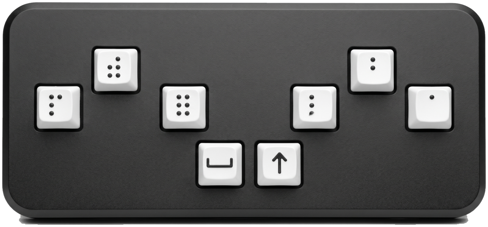

<Frame caption="BrailleBridge BB1 top-down mechanical layout with 6 dot keys, Space, and Shift">
  
</Frame>

BrailleBridge BB1 is built from off-the-shelf, locally replaceable parts paired with a dedicated 2-layer wiring hub PCB (**BB1 Wiring Board v4**) that eliminates breadboard jumper clutter, provides a solid dual-layer ground plane, and supports virtually any locally available battery or DC power supply via a socketed 5 V buck-boost regulator.

## Bill of Materials (BB1 Device + Wiring Board v4)

| Component | Qty | Package / Spec | Purpose |
|---|---|---|---|
| **ESP32 DevKit (38-pin)** | 1 | Dual 19-pin headers (`20.3 mm` row spacing), Micro-USB | 240 MHz dual-core MCU + BLE HID & NUS radio |
| **Outemu Red Switches** | 8 | Linear MX-compatible, 50M cycles | 6 Braille dots (`D1–D6`), `SPACE`, `SHIFT` |
| **BB1 Wiring Board v4** | 1 | `66.0 × 52.0 × 1.2 mm`, 2-layer FR-4, HASL lead-free | Plug-in ESP32 + 5V buck-boost sockets & vertical Dupont hub |
| **`1N5819` Schottky Diodes (`D1`, `D2`)** | 2 | DO-41 (`SOD81`, `10.16 mm` horizontal pitch), `40 V 1 A` | `D2`: reverse-battery protection into module; `D1`: USB back-feed isolation |
| **1×19 Female Sockets (`J2`, `J4`)** | 2 | `2.54 mm` pitch vertical female pin sockets | Plug-in socket for 38-pin ESP32 DevKit |
| **1×04 Female Socket (`J5`)** | 1 | `2.54 mm` pitch vertical female pin socket | Plug-in socket for 5 V buck-boost module (e.g., Pololu S9V11F5) |
| **1×03 Male Header + Jumper Cap (`JP1`)** | 1 + 1 | `2.54 mm` vertical male header + 1× shunt | Power mode selector: `1-2 AA direct` or `2-3 5V module` |
| **1×16 Male Pin Header (`J1`)** | 1 | `2.54 mm` vertical male header | 8 × `(SIG, GND)` switch pairs via F-to-F Dupont wires |
| **1×04 Male Pin Header (`J3`)** | 1 | `2.54 mm` vertical male header | `BAT-`, `BAT+`, `BAT+ > SW`, `SW BACK` power harness |
| **Plug-In 5 V Buck-Boost Module (Optional)** | 0–1 | Reference: Pololu S9V11F5 (`3–16 V` in, `5 V / 1.5 A` out) | Enables NiMH, 2–3×AA, protected Li-ion, 9 V, or DC adapters |
| **Local Battery Pack + Slide Switch** | 1 | Off-board harness (`4×AA`, NiMH, Li-ion, 9 V, or DC) | Portable power tailored to local availability |
| **3D-Printed Keycaps & Enclosure** | 1 set | FDM PLA + M2/M3 fasteners | Ergonomic Braille cell spacing & wrist rest |

<Note>
  **No external resistors, capacitors, or LEDs** are placed on the BB1 Wiring Board v4. All 8 switch channels rely exclusively on the ESP32's internal `INPUT_PULLUP` resistors enabled in `setup()`, keeping `GPIO12` (`D2`, boot-strapping pin) safe at power-on.
</Note>

## Dual-Mode Buck-Boost Power Architecture

### Why a Plug-In Buck-Boost Module? (Global & Local Manufacturing Flexibility)

Supply chains for batteries and chargers vary sharply across countries and regions. A rigid `4×AA` alkaline-only power stage forces schools and local assemblers in regions where rechargeable NiMH packs, protected 18650/Li-ion cells, 2-cell or 3-cell AA holders, 9 V batteries, or standard `5–12 V` DC wall adapters are cheaper or easier to source to redesign the circuit board.

**BB1 Wiring Board v4 solves this at the PCB level** by adding a standard `2.54 mm` 4-pin female socket (`J5`) for an off-the-shelf 5 V step-up/step-down (buck-boost) regulator (reference: **Pololu S9V11F5**, `2–16 V` operating / `3–16 V` startup, `5 V` regulated output up to `1.5 A`) paired with a 3-pin break-before-make selector header (`JP1`):

- **Jumper `JP1` on Pins `1-2` (`1-2 AA direct`, max `6.5 V`)**: Bypasses the buck-boost socket completely — ideal for ultra-low-cost `4×AA` alkaline builds where the module is omitted to save BOM cost.
- **Jumper `JP1` on Pins `2-3` (`2-3 5V module`, `3–16 V` max)**: Routes battery power through reverse-polarity diode `D2` (`1N5819`), into the plug-in 5 V buck-boost regulator (`J5`), and out as a stable 5 V rail (`V5_MOD`) — letting regional manufacturers in Bangladesh, Indonesia, or anywhere else select whatever battery chemistry or power adapter best fits local availability, safety regulations, and school budgets.
- **No jumper installed**: Completely isolates `DIODE_IN` so the ESP32 receives no battery power; because Pin 2 (`DIODE_IN`) is the common center pin, bypass and regulated sources can never be shorted together.

```text
Mode A — Bypass (JP1 1-2, 4xAA direct, max 6.5V):
  Battery (+) ─▶ J3/3 (BAT+) ─▶ J3/2 (BAT+>SW) ─▶ Slide Switch ─▶ J3/1 (SW_BACK)
              ─▶ JP1/1 ==shunt== JP1/2 (DIODE_IN) ─▶ D1 (1N5819, band->VIN) ─▶ VIN ─▶ J2/19 (ESP32 V5)

Mode B — Regulated (JP1 2-3, 5V buck-boost module, 3-16V max):
  Battery (+) ─▶ J3/3 (BAT+) ─▶ J3/2 (BAT+>SW) ─▶ Slide Switch ─▶ J3/1 (SW_BACK)
              ─▶ D2 (1N5819, band->module) ─▶ MOD_IN ─▶ J5/1 (VIN) ─▶ [5V Buck-Boost] ─▶ J5/3 (V5_MOD)
              ─▶ JP1/3 ==shunt== JP1/2 (DIODE_IN) ─▶ D1 (1N5819, band->VIN) ─▶ VIN ─▶ J2/19 (ESP32 V5)

Ground Return (12 pins on dual-layer GND pour):
  Battery (-) ─▶ J3/4 (BAT-) ─▶ Dual-layer GND Pour ─▶ J2/14 & J4/1 (ESP32) + J5/2 (Module GND) + 8× J1 Switch GND
```
