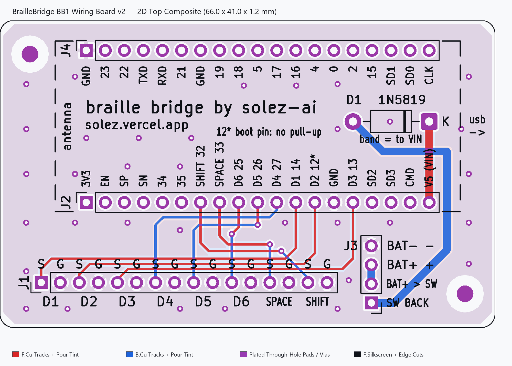
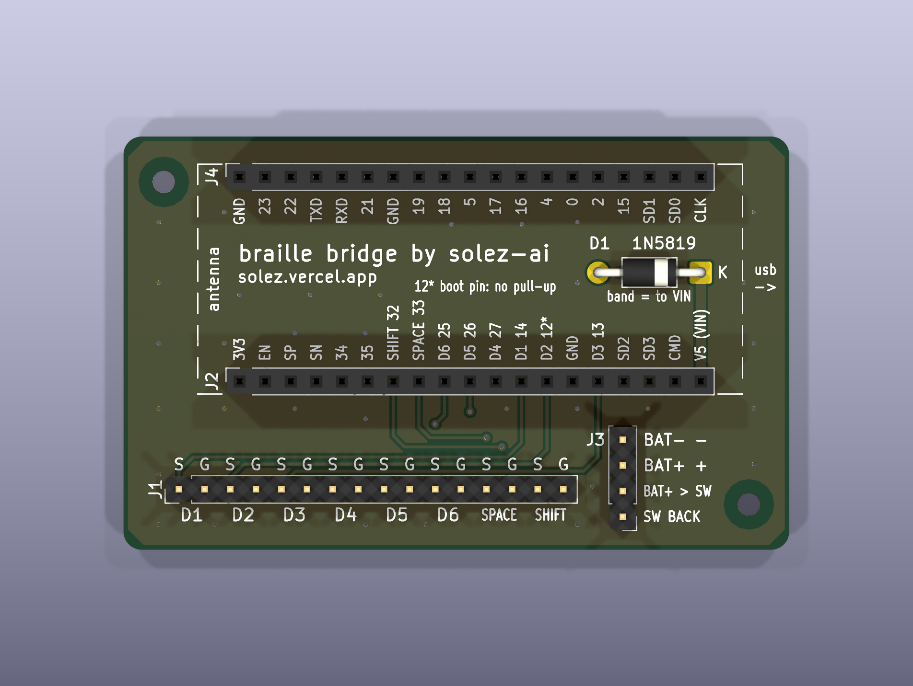
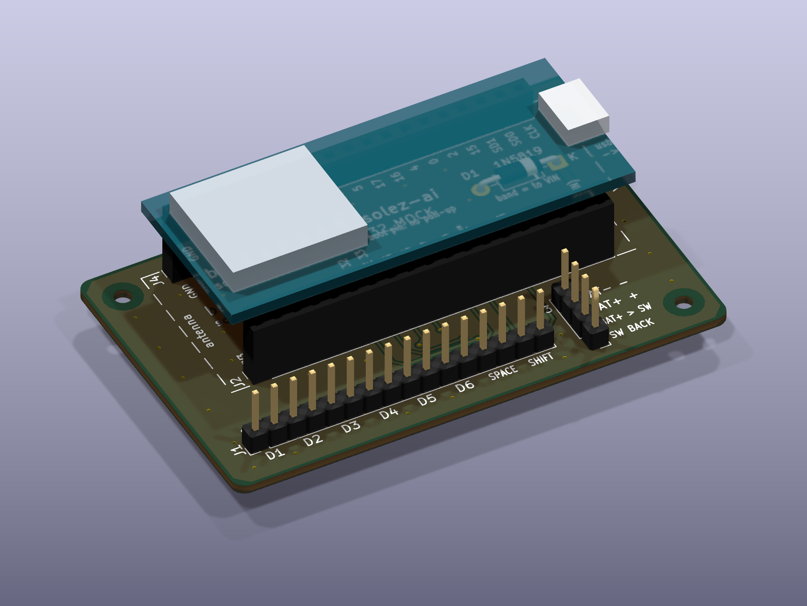
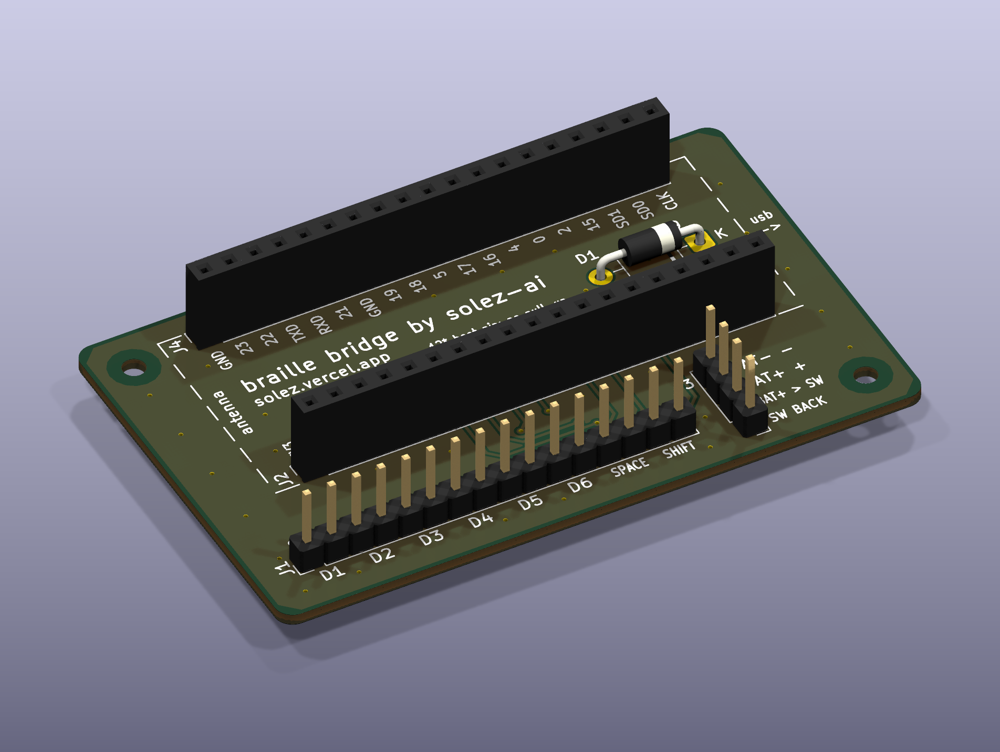
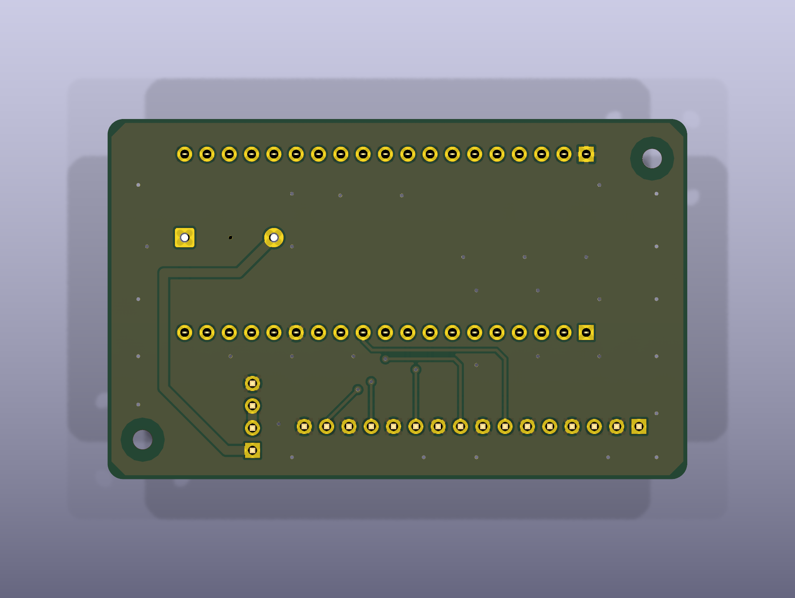
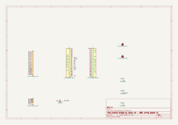

The **BB1 Wiring Board v2** replaces breadboards and perfboard wiring with a compact, JLCPCB-ready **2-layer PCB** engineered in **KiCad 10.0.8**.

<Tabs>
  <Tab title="2D Copper & Silkscreen">
    <Frame caption="2D Top Composite — Red: F.Cu, Blue: B.Cu, Plum: Plated pads/vias, Dark: F.Silkscreen & Edge.Cuts (66.0 × 41.0 × 1.2 mm)">
      
    </Frame>
  </Tab>
  <Tab title="3D Top">
    <Frame caption="3D Top Render showing 38-pin ESP32 female sockets (J2/J4), 1N5819 diode (D1), vertical switch header (J1), and power header (J3)">
      
    </Frame>
  </Tab>
  <Tab title="3D ESP32 Clearance">
    <Frame caption="3D Mechanical Clearance Check with 54.0 × 22.8 mm ESP32 DevKit stand-in seated in J2/J4">
      
    </Frame>
  </Tab>
  <Tab title="3D Isometric & Bottom">
    <Frame caption="Isometric 3D View">
      
    </Frame>
    <Frame caption="Bottom 3D View showing 1.00 mm SW_BACK / BAT_POS power traces and B.Cu signal routing">
      
    </Frame>
  </Tab>
  <Tab title="Schematic">
    <Frame caption="BB1 Wiring Board v2 KiCad Schematic (0 ERC errors, 0 warnings, 0 ignored)">
      
    </Frame>
  </Tab>
</Tabs>

## Manufacturing & Stackup Specification

| Parameter | Value |
|---|---|
| **Dimensions** | `66.0 × 41.0 mm` (`1.8 mm` corner radius) |
| **Layers & Material** | 2 layers, FR-4, **`1.2 mm`** thickness, 1 oz (`0.035 mm`) copper |
| **Surface Finish** | **HASL lead-free** (`HAL lead-free`) |
| **Solder Mask** | Green, `0.05 mm` expansion, `0.10 mm` minimum mask web |
| **Copper Clearances** | `0.40 mm` copper-to-edge (`0.45 mm` GND pour inset), `0.50 mm` thermal spoke / `0.30 mm` gap |
| **Track Widths** | Power (`BAT_POS`, `SW_BACK`, `VIN`): **`1.00 mm`** · Signals (`D1–D6`, `SPACE`, `SHIFT`): **`0.30 mm`** |
| **Vias** | `0.80 mm` pad / `0.40 mm` drill (`34` GND stitching vias + `4` signal vias) |
| **Mounting Holes** | `2 × M2` (`2.2 mm` NPTH drill at `(4.0, 4.5)` & `(62.0, 36.5)`), `5.0 mm` copper keepout |
| **ESP32 Socket Spacing** | `J2` (Row A) ↔ `J4` (Row B) = **`20.300 mm`** (`0.8"`) center-to-center |
| **ERC / DRC Status** | **0 ERC errors/warnings**, **0 DRC violations**, **0 unconnected**, **0 parity errors**, **0 ignored** |

<Warning>
  **Verify ESP32 Row Pitch Before Ordering:** `ESP32_ROW_SPACING_MM` is parameterized at **`20.300 mm` (`0.8"`)** based on a `22.8 mm` wide 38-pin DevKit (`22.8 - 2.54 = 20.3 mm`). Measure your physical DevKit pin-row center-to-center spacing with calipers before submitting Gerbers to JLCPCB.
</Warning>

## Complete 60-Pin Netlist Table

<AccordionGroup>
  <Accordion title="J1 — Switch Header (1×16 Vertical Male, 8 × SIG/GND Pairs)">
    | Pin | Net | Silkscreen | Connects To |
    |---|---|---|---|
    | 1 | `D1` | `S` / `D1` | `J2` Pin 12 (`GPIO 14`) |
    | 2 | `GND` | `G` / `D1` | Shared `GND` pour |
    | 3 | `D2` | `S` / `D2` | `J2` Pin 13 (`GPIO 12*`) |
    | 4 | `GND` | `G` / `D2` | Shared `GND` pour |
    | 5 | `D3` | `S` / `D3` | `J2` Pin 15 (`GPIO 13`) |
    | 6 | `GND` | `G` / `D3` | Shared `GND` pour |
    | 7 | `D4` | `S` / `D4` | `J2` Pin 11 (`GPIO 27`) |
    | 8 | `GND` | `G` / `D4` | Shared `GND` pour |
    | 9 | `D5` | `S` / `D5` | `J2` Pin 10 (`GPIO 26`) |
    | 10 | `GND` | `G` / `D5` | Shared `GND` pour |
    | 11 | `D6` | `S` / `D6` | `J2` Pin 9 (`GPIO 25`) |
    | 12 | `GND` | `G` / `D6` | Shared `GND` pour |
    | 13 | `SPACE` | `S` / `SPACE` | `J2` Pin 8 (`GPIO 33`) |
    | 14 | `GND` | `G` / `SPACE` | Shared `GND` pour |
    | 15 | `SHIFT` | `S` / `SHIFT` | `J2` Pin 7 (`GPIO 32`) |
    | 16 | `GND` | `G` / `SHIFT` | Shared `GND` pour |
  </Accordion>

  <Accordion title="J2 & J4 — 38-Pin ESP32 DevKit Sockets (2 × 1×19 Vertical Female)">
    | Socket / Pin | Net | DevKit Label | Notes |
    |---|---|---|---|
    | `J2` 1–6 | `NC` | `3V3`, `EN`, `SP`, `SN`, `34`, `35` | Isolated copper (`no_connect`) |
    | `J2` 7 | `SHIFT` | `32` | Switch `SHIFT` |
    | `J2` 8 | `SPACE` | `33` | Switch `SPACE` |
    | `J2` 9 | `D6` | `25` | Dot 6 |
    | `J2` 10 | `D5` | `26` | Dot 5 |
    | `J2` 11 | `D4` | `27` | Dot 4 |
    | `J2` 12 | `D1` | `14` | Dot 1 |
    | `J2` 13 | `D2` | `12*` | Dot 2 (boot pin — no pull-up) |
    | `J2` 14 | `GND` | `GND` | Shared `GND` pour |
    | `J2` 15 | `D3` | `13` | Dot 3 |
    | `J2` 16–18 | `NC` | `SD2`, `SD3`, `CMD` | Isolated copper (`no_connect`) |
    | `J2` 19 | `VIN` | `V5` | From `D1` cathode (band) |
    | `J4` 1 | `GND` | `GND` | Shared `GND` pour |
    | `J4` 2–19 | `NC` | `23, 22, TXD, RXD, 21, GND, 19, 18, 5, 17, 16, 4, 0, 2, 15, SD1, SD0, CLK` | Isolated copper (`no_connect`) |
  </Accordion>

  <Accordion title="J3 (Power Header) & D1 (1N5819 Schottky Diode)">
    | Component / Pin | Net | Silkscreen | Connects To |
    |---|---|---|---|
    | `J3` 1 | `SW_BACK` | `SW BACK` | `D1` Pin 2 (Anode) |
    | `J3` 2 | `BAT_POS` | `BAT+ > SW` | `J3` Pin 3 (to slide switch) |
    | `J3` 3 | `BAT_POS` | `BAT+ +` | `J3` Pin 2 (from 4×AA `+`) |
    | `J3` 4 | `GND` | `BAT- -` | Shared `GND` pour |
    | `D1` 1 | `VIN` | `K` (`band = to VIN`) | `J2` Pin 19 (`V5`) |
    | `D1` 2 | `SW_BACK` | `1N5819` | `J3` Pin 1 (`SW BACK`) |
  </Accordion>
</AccordionGroup>

## Deliverables Package (`hardware/bb1_wiring_board_v2/`)

- `bb1_wiring_board_v2_jlcpcb.zip`: Ready-to-order JLCPCB Gerbers & Excellon drill (`.gtl`, `.gbl`, `.gts`, `.gbs`, `.gto`, `.gbo`, `.gm1`, `.drl` — omits `F_Paste`, `B_Paste`, `drl_map.gbr`, and `.gbrjob`).
- `exports/bb1_wiring_board_v2.glb`: Full-detail binary glTF for interactive web 3D viewers.
- `exports/bb1_wiring_board_v2.step`: Mechanical CAD STEP export.
- `exports/bb1_wiring_board_v2_bom.csv` & `exports/bb1_wiring_board_v2_pins.csv`: Complete BOM and 60-pin table.
