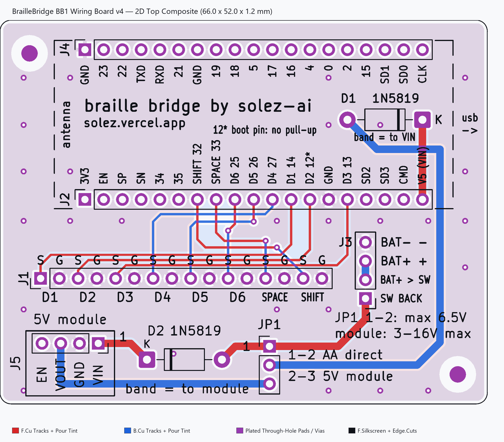
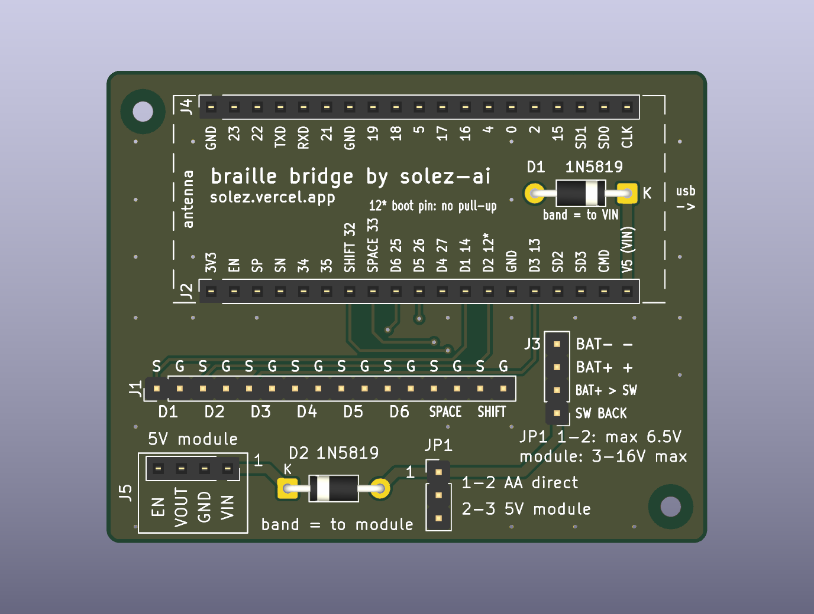
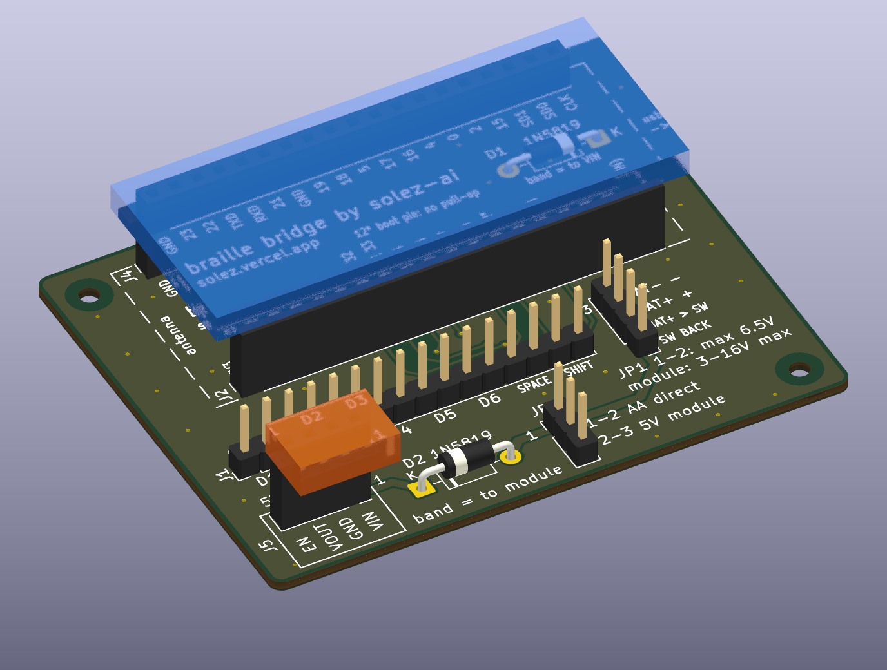
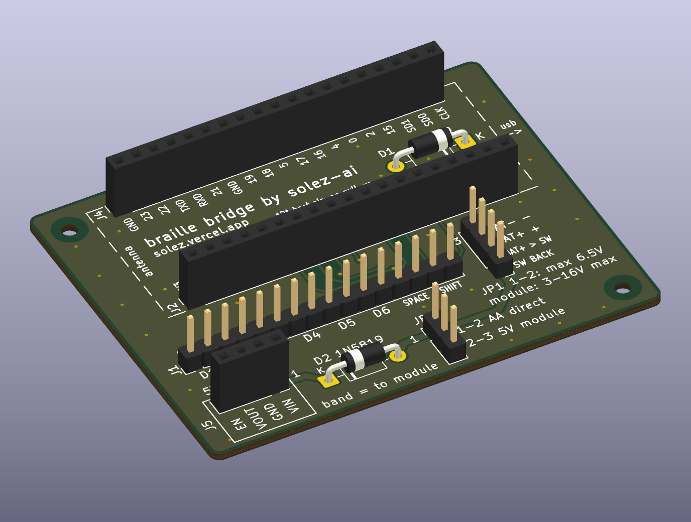
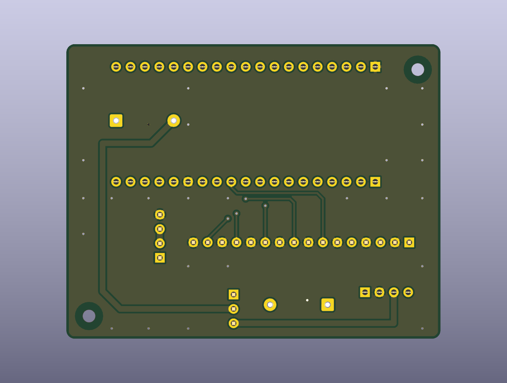

The **BB1 Wiring Board v4** upgrades BrailleBridge's commercial 2-layer PCB (engineered in **KiCad 10**) with a socketed **5 V step-up/step-down (buck-boost) power architecture** (`J5`, `JP1`, `D2`). Manufacturers and makerspaces in any country can assemble the exact same board for ultra-low-cost `4×AA` alkaline packs (`JP1 1-2` bypass) or plug in an off-the-shelf `3–16 V` buck-boost module (`JP1 2-3`) to run on NiMH, 2–3 cell packs, protected Li-ion cells, 9 V batteries, or DC wall adapters — whichever is most accessible locally.

<Tabs>
  <Tab title="2D Copper & Silkscreen">
    <Frame caption="2D Top Composite — Red: F.Cu, Blue: B.Cu, Plum: Plated pads/vias, Dark: F.Silkscreen & Edge.Cuts (66.0 × 52.0 × 1.2 mm)">
      
    </Frame>
  </Tab>
  <Tab title="3D Top">
    <Frame caption="3D Top Render showing 38-pin ESP32 female sockets (J2/J4), switch header (J1), power header (J3), 5V buck-boost socket (J5), selector jumper (JP1), and dual 1N5819 diodes (D1/D2)">
      
    </Frame>
  </Tab>
  <Tab title="3D ESP32 + Module Clearance">
    <Frame caption="3D Mechanical Clearance Check with 54.0 × 22.8 mm ESP32 DevKit on J2/J4 and 11.4 × 7.6 mm Pololu S9V11F5 buck-boost module on J5">
      
    </Frame>
  </Tab>
  <Tab title="3D Isometric & Bottom">
    <Frame caption="Isometric 3D View">
      
    </Frame>
    <Frame caption="Bottom 3D View showing 1.00 mm V5_MOD & DIODE_IN power traces, B.Cu signal routing, and 27 GND stitching vias">
      
    </Frame>
  </Tab>
  <Tab title="Schematic">
    <Frame caption="BB1 Wiring Board v4 KiCad Schematic (0 ERC errors, 0 warnings, 0 ignored)">
      
    </Frame>
  </Tab>
</Tabs>

## Why a Plug-In Buck-Boost Stage? (Local Manufacturing Freedom)

Accessibility hardware deployed across different countries rarely shares a single battery ecosystem. Alkaline AA cells are universal in rural schools, while urban training centers often prefer rechargeable NiMH packs, protected Li-ion packs, 9 V cells, or desktop DC adapters. Soldering a fixed linear regulator or locking the board to one battery voltage forces regional teams to re-spin the PCB for local parts.

By placing a standard `1×04` vertical female socket (`J5`) inside a dedicated `12.0 × 8.8 mm` keep-out zone and pairing it with a `1×03` jumper (`JP1`) and dual `1N5819` protection diodes (`D1`, `D2`):
- **Local manufacturers pick the optimal local power source** without modifying Gerbers, enclosures, or firmware.
- **Zero-cost bypass for `4×AA` builds**: leave `J5` unpopulated and place the shunt on `JP1 1-2` (`max 6.5 V`).
- **Wide-range regulated power (`3–16 V`)**: plug a Pololu S9V11F5 (or pin-compatible 5 V buck-boost module) into `J5` and move the shunt to `JP1 2-3`.
- **Serviceable & foolproof**: the module unplugs without desoldering; `D2` blocks reverse-battery polarity before the module; `D1` blocks USB 5 V back-feed into both batteries and the regulator; and `JP1`'s center-common layout prevents bypass and regulated rails from ever shorting together.

## Manufacturing & Stackup Specification

| Parameter | Value |
|---|---|
| **Dimensions** | `66.0 × 52.0 mm` (`1.5 mm` corner radius) |
| **Layers & Material** | 2 layers, FR-4, **`1.2 mm`** thickness, 1 oz (`0.035 mm`) copper |
| **Surface Finish** | **HASL lead-free** (`HAL lead-free`) |
| **Solder Mask** | Green, `0.05 mm` expansion, `0.10 mm` minimum mask web |
| **Copper Clearances** | `0.40 mm` copper-to-edge (`0.45 mm` GND pour inset), `0.50 mm` thermal spoke / `0.30 mm` gap |
| **Track Widths** | Power (`BAT_POS`, `SW_BACK`, `MOD_IN`, `V5_MOD`, `DIODE_IN`, `VIN`): **`1.00 mm`** · Signals (`D1–D6`, `SPACE`, `SHIFT`): **`0.30 mm`** |
| **Vias** | `0.80 mm` pad / `0.40 mm` drill (`27` GND stitching vias + `4` signal vias = `31` total) |
| **Mounting Holes** | `2 × M2` (`2.2 mm` NPTH drill at `(4.0, 4.5)` & `(62.0, 48.0)`), `5.0 mm` copper keepout |
| **ESP32 Socket Spacing** | `J2` (Row A) ↔ `J4` (Row B) = **`20.300 mm`** (`0.8"`) center-to-center |
| **J5 Module Keep-Out** | `12.0 × 8.8 mm` silkscreen box (`16.55 mm` from ESP32 outline, `7.10 mm` from `J1`, `34.00 mm` from `J3`) |
| **Active Nets / GND Pins** | **`15`** active copper nets · **`12`** GND pins (`11` from v3 + `J5` Pin 2) |
| **ERC / DRC Status** | **0 ERC errors/warnings**, **0 DRC violations**, **0 unconnected**, **0 parity errors**, **0 ignored** |

<Warning>
  **Verify Pin Order & Row Pitch Before Assembly:** `J5` is routed for **`Pin 1 = VIN, Pin 2 = GND, Pin 3 = VOUT, Pin 4 = EN (NC)`** (Pololu S9V11F5), and `J2`/`J4` use **`20.300 mm` (`0.8"`)** row spacing for 38-pin ESP32 DevKits. Always verify physical module pin markings against the silkscreen (`VIN / GND / VOUT / EN`, square pad = Pin 1) before powering on.
</Warning>

## Complete 71-Pin Netlist Table

<AccordionGroup>
  <Accordion title="J5 (5V Buck-Boost Socket), JP1 (Mode Jumper), J3 (Power Header) & D1/D2 (1N5819 Diodes)">
    | Component / Pin | Net | Silkscreen | Connects To |
    |---|---|---|---|
    | `J3` 1 | `SW_BACK` | `SW BACK` | `JP1` Pin 1 + `D2` Pin 2 (Anode) |
    | `J3` 2 | `BAT_POS` | `BAT+ > SW` | `J3` Pin 3 (to off-board slide switch) |
    | `J3` 3 | `BAT_POS` | `BAT+ +` | `J3` Pin 2 (from battery `+`) |
    | `J3` 4 | `GND` | `BAT- -` | Shared `GND` pour |
    | `D2` 1 | `MOD_IN` | `K` (`band = to module`) | `J5` Pin 1 (`VIN`) |
    | `D2` 2 | `SW_BACK` | `1N5819` | `J3` Pin 1 + `JP1` Pin 1 |
    | `J5` 1 | `MOD_IN` | `VIN` (`1`, square pad) | `D2` Pin 1 (Cathode) |
    | `J5` 2 | `GND` | `GND` | Shared `GND` pour (12th GND pin) |
    | `J5` 3 | `V5_MOD` | `VOUT` | `JP1` Pin 3 |
    | `J5` 4 | `NC` | `EN` | Unconnected (`no_connect`; internal pull-up on module) |
    | `JP1` 1 | `SW_BACK` | `1` / `1-2 AA direct` | `J3` Pin 1 + `D2` Pin 2 (bypass path) |
    | `JP1` 2 | `DIODE_IN` | Center common pin | `D1` Pin 2 (Anode) |
    | `JP1` 3 | `V5_MOD` | `2-3 5V module` | `J5` Pin 3 (`VOUT`, regulated path) |
    | `D1` 1 | `VIN` | `K` (`band = to VIN`) | `J2` Pin 19 (`V5`) |
    | `D1` 2 | `DIODE_IN` | `1N5819` | `JP1` Pin 2 (Center common) |
  </Accordion>

  <Accordion title="J1 — Switch Header (1×16 Vertical Male, 8 × SIG/GND Pairs)">
    | Pin | Net | Silkscreen | Connects To |
    |---|---|---|---|
    | 1 | `D1` | `S` / `D1` | `J2` Pin 12 (`GPIO 14`) |
    | 2 | `GND` | `G` / `D1` | Shared `GND` pour |
    | 3 | `D2` | `S` / `D2` | `J2` Pin 13 (`GPIO 12*`) |
    | 4 | `GND` | `G` / `D2` | Shared `GND` pour |
    | 5 | `D3` | `S` / `D3` | `J2` Pin 15 (`GPIO 13`) |
    | 6 | `GND` | `G` / `D3` | Shared `GND` pour |
    | 7 | `D4` | `S` / `D4` | `J2` Pin 11 (`GPIO 27`) |
    | 8 | `GND` | `G` / `D4` | Shared `GND` pour |
    | 9 | `D5` | `S` / `D5` | `J2` Pin 10 (`GPIO 26`) |
    | 10 | `GND` | `G` / `D5` | Shared `GND` pour |
    | 11 | `D6` | `S` / `D6` | `J2` Pin 9 (`GPIO 25`) |
    | 12 | `GND` | `G` / `D6` | Shared `GND` pour |
    | 13 | `SPACE` | `S` / `SPACE` | `J2` Pin 8 (`GPIO 33`) |
    | 14 | `GND` | `G` / `SPACE` | Shared `GND` pour |
    | 15 | `SHIFT` | `S` / `SHIFT` | `J2` Pin 7 (`GPIO 32`) |
    | 16 | `GND` | `G` / `SHIFT` | Shared `GND` pour |
  </Accordion>

  <Accordion title="J2 & J4 — 38-Pin ESP32 DevKit Sockets (2 × 1×19 Vertical Female)">
    | Socket / Pin | Net | DevKit Label | Notes |
    |---|---|---|---|
    | `J2` 1–6 | `NC` | `3V3`, `EN`, `SP`, `SN`, `34`, `35` | Isolated copper (`no_connect`) |
    | `J2` 7 | `SHIFT` | `32` | Switch `SHIFT` |
    | `J2` 8 | `SPACE` | `33` | Switch `SPACE` |
    | `J2` 9 | `D6` | `25` | Dot 6 |
    | `J2` 10 | `D5` | `26` | Dot 5 |
    | `J2` 11 | `D4` | `27` | Dot 4 |
    | `J2` 12 | `D1` | `14` | Dot 1 |
    | `J2` 13 | `D2` | `12*` | Dot 2 (boot pin — no pull-up) |
    | `J2` 14 | `GND` | `GND` | Shared `GND` pour |
    | `J2` 15 | `D3` | `13` | Dot 3 |
    | `J2` 16–18 | `NC` | `SD2`, `SD3`, `CMD` | Isolated copper (`no_connect`) |
    | `J2` 19 | `VIN` | `V5` | From `D1` cathode (band) |
    | `J4` 1 | `GND` | `GND` | Shared `GND` pour |
    | `J4` 2–19 | `NC` | `23, 22, TXD, RXD, 21, GND, 19, 18, 5, 17, 16, 4, 0, 2, 15, SD1, SD0, CLK` | Isolated copper (`no_connect`) |
  </Accordion>
</AccordionGroup>

## Deliverables Package (`hardware/bb1_wiring_board_v4/`)

- `bb1_wiring_board_v4_jlcpcb.zip`: Ready-to-order JLCPCB Gerbers & Excellon drill (`.gtl`, `.gbl`, `.gts`, `.gbs`, `.gto`, `.gbo`, `.gm1`, `.drl` — omits `F_Paste`, `B_Paste`, `drl_map.gbr`, and `.gbrjob`).
- `exports/bb1_wiring_board_v4.glb`: Full-detail binary glTF for interactive web 3D viewers.
- `exports/bb1_wiring_board_v4.step`: Mechanical CAD STEP export.
- `exports/bb1_wiring_board_v4_bom.csv` & `exports/bb1_wiring_board_v4_pins.csv`: Complete BOM (including `J5`, `JP1 + shunt`, and `2× 1N5819`) and 71-pin netlist table.
