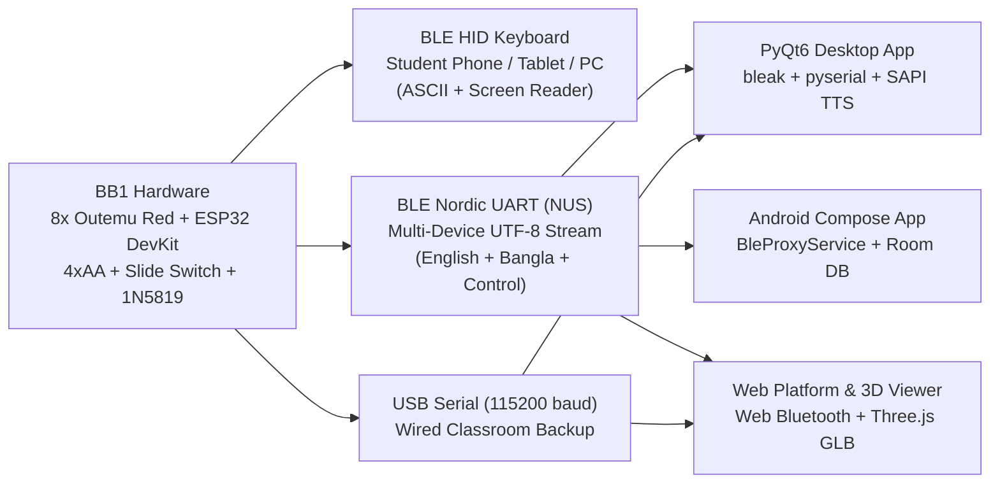

<Frame caption="BrailleBridge BB1 hardware unit with 6-dot Outemu Red mechanical switches, Space, and Shift">
  
</Frame>

**BrailleBridge (`b°bridge`)** is an open-source, commercial-ready bilingual Braille writing and multi-student classroom ecosystem built by **Solez AI**. Blind and visually impaired students type familiar six-dot Braille chords on a tactile mechanical keyboard (`~$12` BOM), while an ESP32 microcontroller decodes each chord on release and streams translated English or Bangla text over **Bluetooth Low Energy (BLE HID + Nordic UART Service)** and **USB Serial (`115200` baud)** simultaneously.

<CardGroup cols={2}>
  <Card title="Architecture & How It Works" icon="gears" href="/how-it-works">
    Decode-on-release chording, dual BLE HID + NUS GATT channels, USB Serial, and multi-bridge classroom routing.
  </Card>
  <Card title="BB1 Wiring Board v2 (PCB)" icon="microchip" href="/hardware/pcb-v2">
    Custom 2-layer KiCad 10 PCB (66 × 41 × 1.2 mm), 38-pin ESP32 DevKit sockets, 1N5819 power chain, and 0-violation DRC.
  </Card>
  <Card title="PyQt6 Desktop Console" icon="desktop" href="/desktop/overview">
    Multi-device BLE + USB Serial classroom console with Student, Teacher, Smart-Formatted Logs, and Learn modes.
  </Card>
  <Card title="Android Companion App" icon="mobile" href="/android/overview">
    Jetpack Compose + Material 3 app with foreground `BleProxyService` supporting simultaneous multi-bridge connections.
  </Card>
</CardGroup>

## System Architecture

## End-to-End Pipeline

<Steps>
  <Step title="Student presses a Braille chord">
    Six dot switches (`GPIO 14, 12*, 13, 27, 26, 25`), Space (`GPIO 33`), and Shift (`GPIO 32`) are polled through a `15 ms` debounce filter using ESP32 internal `INPUT_PULLUP` resistors.
  </Step>
  <Step title="Firmware decodes on key release">
    Instead of a fixed timer, `braile.ino` accumulates the 6-bit dot mask while keys are held and commits the chord as soon as all dot keys are released (with a `5,000 ms` stuck-key guard).
  </Step>
  <Step title="Dual Bluetooth + USB broadcast">
    ASCII characters fire as standard **BLE HID** keystrokes (read aloud by TalkBack/VoiceOver/Narrator) while both ASCII and multi-byte Bangla UTF-8 stream over **BLE NUS** (`6E400001-...`) and **USB Serial** at `115200` baud.
  </Step>
  <Step title="Multi-bridge classroom ingestion">
    Teachers connect **multiple BrailleBridge units concurrently** over Bluetooth (desktop `bleak` / WinRT or Android `BleProxyService`) or USB Serial — monitoring live feeds, translating, and exporting formatted `.txt` / `.log` transcripts.
  </Step>
</Steps>
